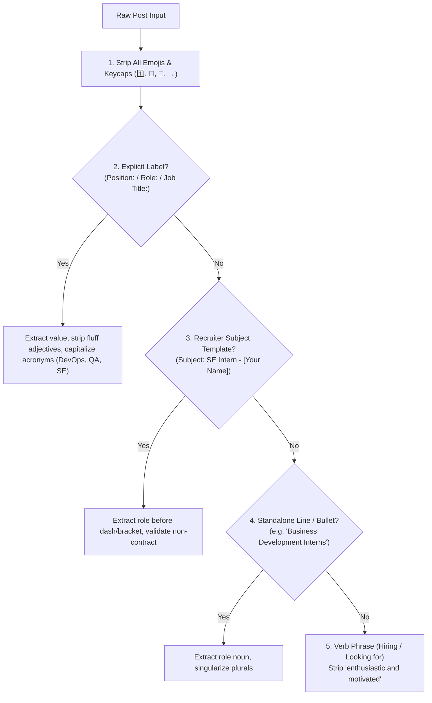

# 📖 Ahmad Faraz — Professional Outreach Email Playbook

> **Purpose:** Practical engineering guide and anti-slop rules for drafting, extracting, and dispatching job applications.  
> **Mandate:** Zero emojis, canonical title normalization, recruiter subject compliance, and authentic human tone.  

---

## 🚫 1. The Disallowed Patterns (Real Failure Post-Mortem)

Below are three real negative examples discovered in sent mail, why they happened, and how the system prevents them permanently:

### Failure Case 1: Adjective Pollution in Job Title
- ❌ **What was sent:** `Subject: Application for Enthusiastic And Motivated Devops Intern - Ahmad Faraz`
- 🧐 **Root Cause:** Recruiter wrote *"TekDex is looking for enthusiastic and motivated DevOps Interns"*. Brittle regex captured the marketing adjectives `"enthusiastic and motivated"` as part of the title!
- ✅ **The Rule:** Strip all marketing and emotional adjectives (`enthusiastic`, `motivated`, `passionate`, `talented`, `energetic`, `driven`, `seasoned`, `ambitious`, `fresh`). The title is **DevOps Intern**.
- 🎯 **Correct Output:** `Subject: Application for DevOps Intern - Ahmad Faraz`

### Failure Case 2: Recruiter Bullet / Number Emojis in Title
- ❌ **What was sent:** `Subject: Application for 1️⃣ Business Development Interns - Ahmad Faraz`
- 🧐 **Root Cause:** Recruiter listed openings as `1️⃣ Business Development Interns`. The keycap emoji `1️⃣` and plural `s` leaked into the title!
- ✅ **The Rule:** Strip all emoji characters, keycaps, numbers, and bullet symbols (`1️⃣`, `2️⃣`, `🔹`, `→`, `•`, `-`, `*`). Convert plurals to singular.
- 🎯 **Correct Output:** `Subject: Application for Business Development Intern - Ahmad Faraz`

### Failure Case 3: Duration / Contract Text as Title
- ❌ **What was sent:** `Subject: Application for → 2–3 Month Paid Internship - Ahmad Faraz`
- 🧐 **Root Cause:** Post wrote *"The role:\n→ 2–3 month paid internship"*. The system grabbed the contract duration instead of the genuine job title (`SE Intern`).
- ✅ **The Rule:** Never accept titles containing duration/contract words (`month`, `year`, `paid`, `unpaid`, `stipend`, `converts to`, `shift`, `timings`, `pkr`, `salary`).
- 🎯 **Correct Output:** `Subject: SE Intern - Ahmad Faraz`

---

## 🏗️ 2. Title Extraction Hierarchy (In Strict Order)

When parsing any raw post, resolve the title using this strict priority cascade:



1. **Priority 1 — Explicit Position / Role Label:**
   - Look for `Position:`, `Role:`, `Job Title:`.
   - In TekDex: `📌 Position: DevOps Intern` &rarr; `Position: DevOps Intern` &rarr; **DevOps Intern**.
2. **Priority 2 — Recruiter-Mandated Subject:**
   - Look for `Subject: <Role> - [Your Name]`.
   - In Devkiosk: `Subject: SE Intern – [Your Name]` &rarr; **SE Intern**.
3. **Priority 3 — Standalone Role Line:**
   - In KaveLogics: `1️⃣ Business Development Interns` &rarr; **Business Development Intern**.
4. **Priority 4 — Headline / Verb Phrase (with Fluff Stripping):**
   - In TekDex: `looking for enthusiastic and motivated DevOps Interns` &rarr; strip fluff &rarr; **DevOps Intern**.

---

## 📧 3. Subject Line Formulation Matrix

| Scenario in Post | Example Post Text | Required Subject Line |
|---|---|---|
| **Recruiter specified template with name placeholder** | `Subject: SE Intern – [Your Name]` | `SE Intern - Ahmad Faraz` |
| **Recruiter specified template with angled brackets** | `Subject: Python Developer - <Name>` | `Python Developer - Ahmad Faraz` |
| **Recruiter specified code or plain title** | `Mention 'QA Intern' in subject` | `QA Intern - Ahmad Faraz` |
| **No subject mentioned in post** | *No subject line instruction* | `Application for [Job Title] - Ahmad Faraz` |

---

## 📝 4. Standard Email Skeleton

Every outgoing email must strictly adhere to this clean, plain-text structure:

```text
Hello [Company] team,

[Tailored Pitch: 2–3 sentences highlighting matching stack, projects, and work ethic].

I'm based in Sargodha and open to discussing remote work or relocation if needed. I've attached my CV for your review and would be glad to talk about how I can contribute if my background is a match.

Regards,
Ahmad Faraz
LinkedIn: https://www.linkedin.com/in/ahmad-faraz-/
GitHub: https://github.com/ahmadfaraz2
```

- **Greeting:** Always `Hello [Company] team,`
- **Paragraph 1:** The dynamically tailored pitch paragraph (matching post's tech stack honestly).
- **Paragraph 2:** Location, willingness to relocate/remote, CV attachment reference.
- **Signature:** Standard authentic contact details.
- **Zero Emojis:** 100% plain text.
