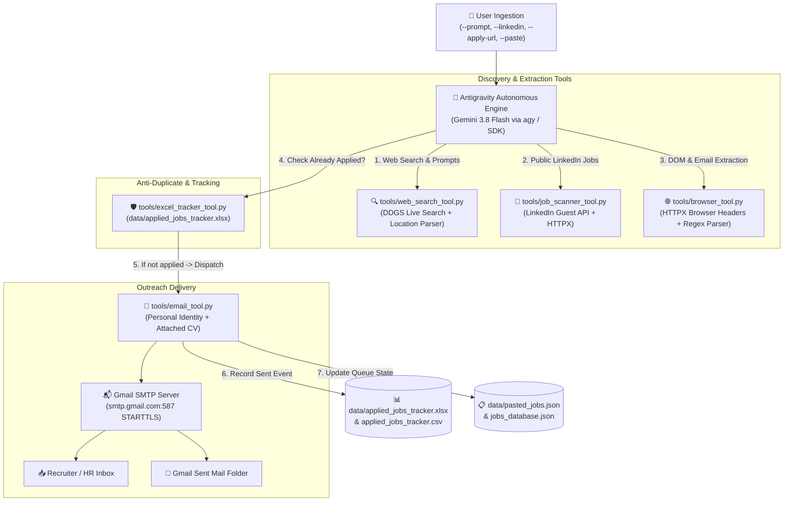

# 🚀 Agentic Job Applier — Autonomous Job Outreach & Application System (v1.3.0)

An intelligent, autonomous job hunting and direct outreach pipeline built with the **Google Antigravity SDK** (`google-antigravity`), powered by **live web search**, **HTTPX browser emulation**, and an active authenticated Google Antigravity CLI session (`agy` with Gemini 3.8 Flash) — **with ZERO Gemini API key required**.

All outgoing application emails represent your genuine sender identity, authentic tone, contact details, and attached CV, protected by an **Excel tracking and anti-duplicate engine**.

---

## 👤 Candidate Application Profile

- **Sender Identity**: `Your Name <your_email@gmail.com>` *(Authenticated personal sender)*
- **Contact Details**:
  - **Location**: Your City, Country (Open to Remote & Relocation)
  - **LinkedIn**: [linkedin.com/in/your-profile](https://www.linkedin.com)
  - **GitHub**: [github.com/your-username](https://github.com)
- **CV Attachment**: Automatically attaches your CV PDF from `data/` to every application email.
- **Application Format**: **100% Pure Organic Plain Text** (`text/plain`). No HTML newsletters, marketing cards, or robotic templates — matches genuine Gmail sent emails.

---

## 🏛️ System Architecture



---

## ✨ Key Capabilities

### 1. Natural Language Web Job Search (`--prompt`)
Type free-form prompts such as `"search for jobs in lahore, Islamabad about internships and jobs"`. The parser automatically identifies:
- **Locations**: Lahore, Islamabad, Rawalpindi, Karachi, Remote.
- **Role Types**: Internships, Trainee, Fresh Graduate, Junior, Full-time.
- **Tech Stack**: Python, Django, FastAPI, React, AI Agents.
- Returns real openings from **Indeed Pakistan**, **Rozee.pk**, **LinkedIn**, and company career pages.

### 2. Live Public LinkedIn Crawler (`--linkedin`)
Scrapes live public job postings directly from LinkedIn's guest search endpoint with zero login walls or account checkpoint risks.

### 3. Direct URL Inspector & Automated Outreach (`--apply-url`)
Inspects any company career page or job listing URL via HTTPX:
- Extracts job title, company name, and requirements.
- Automatically discovers recruiter contact emails (`mailto:` and text patterns).
- Drafts an organic application email with CV attached.

### 4. Excel Application Tracker & Anti-Duplicate Guard
- Persists all sent applications into a native Excel workbook ([`data/applied_jobs_tracker.xlsx`](file:///F:/Antigravity-cli/job-automation-smtp/data/applied_jobs_tracker.xlsx)) with formatted green status badges and timestamps.
- **Strict Anti-Duplicate Guard**: Checks recipient email and company name before sending — **permanently prevents accidental double-sending to the same recruiter or company**.

### 5. Dynamic Skills Customizer
Analyzes each job description and dynamically tailors the pitch paragraph to emphasize the exact tech stack required:
- **Backend / APIs**: Focuses on Python (FastAPI/Django), REST architecture, SQL/PostgreSQL.
- **Frontend / Fullstack**: Emphasizes React, JavaScript, responsive UI, component state design.
- **QA & Automation**: Focuses on Playwright, Selenium, test automation, and debugging.
- **AI Agents**: Highlights autonomous workflow orchestration, LLMs, tool-calling pipelines.

### 6. Inbound Reply & Interview Detector (`--check-replies`)
Monitors your Gmail inbox via IMAP SSL, matches responses from applied companies, and categorizes incoming messages:
- 🟢 **Interview Invites** *(e.g. recruiter response detected)*
- 🟡 **Technical Assessments / Coding Tests**
- 💬 **Recruiter Inquiries**
- 🔴 **Status Updates / Rejections**
Automatically updates the Excel tracker status to `INTERVIEW INVITE` and triggers Discord alerts.

### 7. Real-Time Discord Notifications (`--test-discord`)
Dispatches instant rich embed notifications to your Discord channel whenever:
- A new application is delivered with your CV.
- A recruiter replies or schedules an interview.

### 8. Smart Raw Post Parser (`--paste`, `--post`, `--post-file`)
Takes completely unformatted, messy text from any LinkedIn hiring post, email, or announcement in one go (no tedious 5-question wizards!):
- Automatically extracts **Company Name**, **Job Title / Role**, **Recruiter Email**, and **Location**.
- Resolves company aliases & domains (e.g. `talent@systemsltd.com` -> `Systems Limited`).
- Automatically generates the customized pitch.
- Checks against [`applied_jobs_tracker.xlsx`](file:///F:/Antigravity-cli/job-automation-smtp/data/applied_jobs_tracker.xlsx) to prevent duplicate outreach.
- Prompts for a single 1-key confirmation to dispatch (`Enter` = Yes!).

### 9. Interactive Discord Bot & DM Outreach Assistant (`--discord-bot`, `discord_bot.py`)
Paste raw LinkedIn posts or upload mobile screenshots directly into private Discord DMs from your phone or PC:
- **Instant Screenshot OCR**: Hardware-accelerated local OCR reads phone screenshots in milliseconds.
- **Model Intelligence**: Gemini 3.8 Flash extracts Company, Job Title, Recruiter Email, and exact Subject requirements.
- **Interactive UI Preview**: Delivers a formatted embed with full details and dynamic pitch.
- **1-Click Dispatch**: Press **`[🚀 Send Application Email]`** to send with CV attached.
- **Native Slash Commands**: `/apply`, `/stats`, `/check`, `/history`, `/help`.
- See [`DISCORD_BOT_GUIDE.md`](file:///F:/Antigravity-cli/job-automation-smtp/DISCORD_BOT_GUIDE.md) for 2-minute setup instructions.

---

## 🛠️ CLI Usage & Command Reference

Navigate to the project directory:
```powershell
cd F:\Antigravity-cli\job-automation-smtp
```

### Complete Command Cheat Sheet

| Command | Purpose |
|---|---|
| `python run.py --prompt "query"` | Search web & job boards via natural prompt and apply interactively |
| `python run.py --prompt` | Interactive prompt mode to search jobs and internships |
| `python run.py --linkedin "Python" --location "Lahore"` | Search live LinkedIn openings and apply directly |
| `python run.py --apply-url "<URL>"` | Inspect any job posting URL, extract recruiter email, and apply |
| `python run.py --apply-url "<URL>" --to "hr@comp.com"` | Apply to a specific URL with an explicit recruiter email override |
| `python run.py --paste` | Paste complete raw LinkedIn post to auto-extract, draft, and dispatch |
| `python run.py --post "<raw text>"` | Pass raw LinkedIn post directly via CLI argument to parse and apply |
| `python run.py --post-file "post.txt"` | Read raw post from file to auto-extract, draft, and dispatch |
| `python run.py --apply-queue` | Dispatch application emails to all pending jobs in queue |
| `python run.py --check-replies` | Scan Gmail inbox for recruiter responses, detect interviews, and update Excel & Discord |
| `python run.py --test-discord` | Send a test notification to your configured Discord webhook |
| `python discord_bot.py` *(or `--discord-bot`)* | Launch interactive Discord bot for DM-based post parsing & 1-click apply |
| `python run.py --daemon --discord-bot` | Run background automated scraper daemon + Discord bot concurrently |
| `python run.py --tracker` | View application statistics and Excel tracker file details |
| `python run.py --test-cv` | Send a preview application email with CV attached to your inbox |
| `python run.py --test-smtp` | Test Gmail SMTP connection and credentials |
| `python run.py --browse "<URL>"` | Inspect raw/cleaned text of any web page via browser tool |
| `python run.py --history` | View historical evaluated opportunities from database |
| `python run.py --daemon --interval 3600` | Run autonomous background sweep every hour |

---

## 📊 Live Application Track Record

Current verified applications dispatched and recorded in [`data/applied_jobs_tracker.xlsx`](file:///F:/Antigravity-cli/job-automation-smtp/data/applied_jobs_tracker.xlsx):

| ID | Timestamp | Company | Role Applied | Recruiter Email | Status |
|:---:|:---:|---|---|---|:---:|
| **APP-0001** | `2026-10-29 23:07` | **Rolustech** | Associate Software Engineer | `Careers@rolustech.com` | **INTERVIEW INVITE 🟢** |
| **APP-0002** | `2026-10-29 23:07` | **Contour Software** | Trainee Software Developer | `careers@contour-software.com` | **APPLIED** |
| **APP-0003** | `2026-10-29 23:07` | **Clustox** | Software Engineering Intern | `hr@clustox.com` | **APPLIED** |
| **APP-0004** | `2026-10-29 23:11` | **Prime System Solutions** | Trainee Engineer (Internship to Hire) | `info@primesystemsolutions.com` | **APPLIED** |
| **APP-0005** | `2026-10-29 23:11` | **KryptoMind LLC** | Software QA / Python Intern | `jobs@kryptomind.com` | **APPLIED** |

---

## 📁 Project Structure

```
job-automation-smtp/
├── .env                          # Real Gmail SMTP credentials & alert email
├── .env.example                  # Template configuration file
├── requirements.txt              # Dependencies (google-antigravity, httpx, openpyxl, ddgs, etc.)
├── config.py                     # Central configuration loader
├── discord_bot.py                # Interactive Discord DM Bot & 1-Click Apply view
├── DISCORD_BOT_GUIDE.md          # 2-minute Discord bot setup and command guide
├── run.py                        # Unified CLI runner with all command flags
├── workflow.py                   # Antigravity SDK Agent orchestration
├── antigravity_cli_agent.py      # Zero-API-key bridge leveraging authenticated agy session
├── test_smtp.py                  # Standalone SMTP connection tester
├── data/
│   ├── your_cv.pdf               # Your CV PDF attached to applications (or any *.pdf in data/)
│   ├── applied_jobs_tracker.xlsx # Formatted Excel tracking workbook (Anti-duplicate source)
│   ├── applied_jobs_tracker.csv  # Companion CSV file
│   ├── pasted_jobs.json          # Queue for copy-pasted job opportunities
│   └── jobs_database.json        # Persistent database for scored opportunities
└── tools/
    ├── __init__.py
    ├── browser_tool.py           # HTTPX browser agent & contact email regex extractor
    ├── discord_alert_tool.py     # Discord Webhook notifications for applications & replies
    ├── email_tool.py             # SMTP dispatcher with anti-duplicate check & CV attachment
    ├── excel_tracker_tool.py     # openpyxl Excel tracking and deduplication engine
    ├── inbox_listener_tool.py    # Gmail IMAP listener & interview invite classifier
    ├── job_scanner_tool.py       # LinkedIn public guest crawler & pasted queue manager
    ├── pitch_customizer_tool.py  # Dynamic Skills Customizer tailored to job specs
    ├── post_parser_tool.py       # Smart raw post parser (auto extracts company, role, email)
    ├── web_search_tool.py        # DDGS live web search & natural language prompt parser
    ├── read_sent_emails.py       # Gmail IMAP utility used to inspect sent email patterns
    └── tracker_tool.py           # State management & qualification tracker
```

---

## 🔐 Environment Variables (`.env`)

```ini
# Gmail SMTP Credentials
SMTP_HOST=smtp.gmail.com
SMTP_PORT=587
SMTP_USE_TLS=True
SMTP_USER=your_email@gmail.com
SMTP_PASSWORD=your_gmail_app_password
SMTP_FROM_NAME="Your Full Name"
ALERT_RECIPIENT_EMAIL=your_email@gmail.com

# Job Automation Preferences
JOB_SEARCH_QUERY=Python Developer
MIN_HOURLY_RATE=0.0
REMOTE_ONLY=False
SCAN_INTERVAL_SECONDS=3600
```
